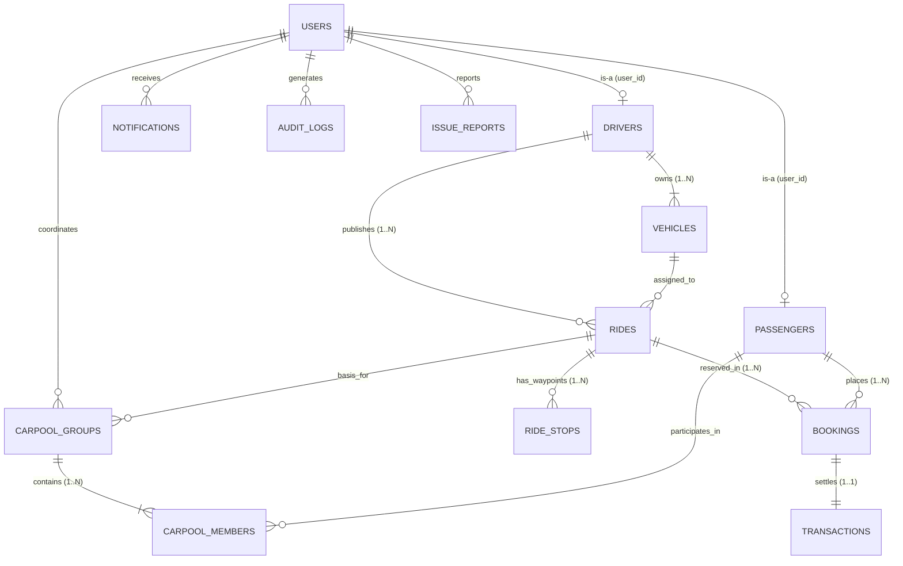

# CARPOOLX — Entity Relationship Diagram & Relational Schema
**Academic DBMS Project Documentation**
**RDBMS**: MySQL 8.0 / InnoDB | **Normalized Level**: 3NF (Third Normal Form)

---

## 1. Relational Entities & Cardinalities

---

## 2. Relational Schema Specification

### 1. `USERS`
- **user_id** (INT, PK, Auto-Increment)
- full_name (VARCHAR(120), NOT NULL)
- email (VARCHAR(160), NOT NULL, UNIQUE)
- phone (VARCHAR(20), NOT NULL)
- password_hash (VARCHAR(255), NOT NULL)
- role (ENUM('passenger', 'driver', 'admin', 'coordinator'), NOT NULL)
- rating (DECIMAL(3, 2), DEFAULT 5.00)
- total_rides_count (INT, DEFAULT 0)
- created_at (TIMESTAMP)

### 2. `PASSENGERS`
- **passenger_id** (INT, PK, FK $\rightarrow$ USERS.user_id ON DELETE CASCADE)
- emergency_contact (VARCHAR(20))
- preferred_payment_mode (ENUM('upi', 'card', 'wallet', 'cash'))
- corporate_domain (VARCHAR(100))
- total_spent (DECIMAL(10, 2), DEFAULT 0.00)
- carbon_saved_kg (DECIMAL(8, 2), DEFAULT 0.00)

### 3. `DRIVERS`
- **driver_id** (INT, PK, FK $\rightarrow$ USERS.user_id ON DELETE CASCADE)
- license_number (VARCHAR(50), NOT NULL, UNIQUE)
- license_expiry (DATE, NOT NULL)
- is_verified (BOOLEAN, DEFAULT TRUE)
- total_earnings (DECIMAL(10, 2), DEFAULT 0.00)
- pending_settlement (DECIMAL(10, 2), DEFAULT 0.00)
- acceptance_rate (DECIMAL(5, 2), DEFAULT 98.50)

### 4. `VEHICLES`
- **vehicle_id** (INT, PK, Auto-Increment)
- driver_id (INT, NOT NULL, FK $\rightarrow$ DRIVERS.driver_id ON DELETE CASCADE)
- make_model (VARCHAR(100), NOT NULL)
- registration_number (VARCHAR(30), NOT NULL, UNIQUE)
- vehicle_type (ENUM('sedan', 'suv', 'hatchback', 'ev_crossover'))
- fuel_type (ENUM('electric', 'petrol', 'diesel', 'cng'))
- total_capacity (INT, NOT NULL, CHECK: between 1 and 8)

### 5. `RIDES`
- **ride_id** (INT, PK, Auto-Increment)
- driver_id (INT, NOT NULL, FK $\rightarrow$ DRIVERS.driver_id)
- vehicle_id (INT, NOT NULL, FK $\rightarrow$ VEHICLES.vehicle_id)
- origin_name (VARCHAR(150), NOT NULL)
- origin_lat (DECIMAL(10, 7), NOT NULL)
- origin_lng (DECIMAL(10, 7), NOT NULL)
- destination_name (VARCHAR(150), NOT NULL)
- destination_lat (DECIMAL(10, 7), NOT NULL)
- destination_lng (DECIMAL(10, 7), NOT NULL)
- departure_time (DATETIME, NOT NULL)
- estimated_arrival (DATETIME, NOT NULL)
- estimated_distance_km (DECIMAL(6, 2), NOT NULL)
- estimated_duration_min (INT, NOT NULL)
- total_seats (INT, NOT NULL, CHECK: 1..8)
- available_seats (INT, NOT NULL, CHECK: >= 0 and <= total_seats)
- fare_per_seat (DECIMAL(8, 2), NOT NULL, CHECK: >= 0)
- status (ENUM('active', 'completed', 'cancelled', 'in_transit'))
- corridor_name (VARCHAR(100))

### 6. `RIDE_STOPS`
- **stop_id** (INT, PK, Auto-Increment)
- ride_id (INT, NOT NULL, FK $\rightarrow$ RIDES.ride_id ON DELETE CASCADE)
- stop_name (VARCHAR(150), NOT NULL)
- stop_order (INT, NOT NULL)
- stop_lat (DECIMAL(10, 7), NOT NULL)
- stop_lng (DECIMAL(10, 7), NOT NULL)
- estimated_stop_time (DATETIME, NOT NULL)
- fare_from_origin (DECIMAL(8, 2), NOT NULL)

### 7. `BOOKINGS`
- **booking_id** (INT, PK, Auto-Increment)
- ride_id (INT, NOT NULL, FK $\rightarrow$ RIDES.ride_id)
- passenger_id (INT, NOT NULL, FK $\rightarrow$ PASSENGERS.passenger_id)
- seats_booked (INT, NOT NULL, CHECK: > 0)
- pickup_point (VARCHAR(150), NOT NULL)
- dropoff_point (VARCHAR(150), NOT NULL)
- total_fare (DECIMAL(8, 2), NOT NULL)
- status (ENUM('pending', 'confirmed', 'rejected', 'cancelled', 'completed'))
- booking_time (TIMESTAMP, DEFAULT CURRENT_TIMESTAMP)
- cancellation_reason (VARCHAR(255) NULL)

### 8. `TRANSACTIONS`
- **transaction_id** (VARCHAR(64), PK)
- booking_id (INT, NOT NULL, FK $\rightarrow$ BOOKINGS.booking_id)
- passenger_id (INT, NOT NULL, FK $\rightarrow$ PASSENGERS.passenger_id)
- driver_id (INT, NOT NULL, FK $\rightarrow$ DRIVERS.driver_id)
- amount (DECIMAL(8, 2), NOT NULL)
- payment_method (ENUM('upi', 'card', 'wallet', 'cash', 'simulated_instant'))
- payment_status (ENUM('success', 'pending', 'refunded', 'failed'))
- gateway_reference (VARCHAR(100), NOT NULL)
- transaction_type (ENUM('fare_payment', 'cancellation_refund', 'driver_payout'))

---

## 3. Database Normalization (3NF Proof)

1. **First Normal Form (1NF)**:
   - All attributes contain atomic, scalar values (e.g., intermediate stops are normalized into `RIDE_STOPS` rather than a comma-separated column).
   - Each table has an explicit Primary Key.
2. **Second Normal Form (2NF)**:
   - All non-key attributes are fully functionally dependent on the primary key.
   - For junction tables (`CARPOOL_MEMBERS`), attributes depend on composite uniqueness `(group_id, passenger_id)`.
3. **Third Normal Form (3NF)**:
   - No transitive dependencies exist. Driver vehicle information is stored in `VEHICLES`, not duplicated inside `RIDES` or `BOOKINGS`. Driver personal info is in `USERS` and `DRIVERS`.
